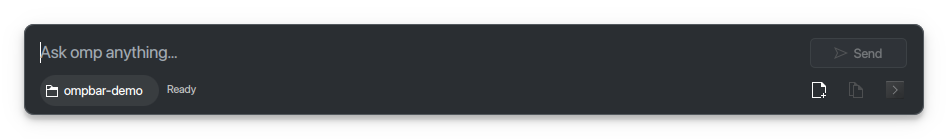
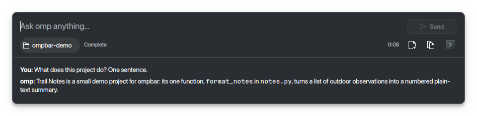

# ompbar

A native KDE Plasma quick-question popup for the `omp` coding agent.

[](https://github.com/DarkoKuzmanovic/ompbar/actions/workflows/ci.yml)
[](LICENSE)

> ompbar is an independent third-party interface for the `omp` agent. It is not affiliated with the omp / Oh My Pi project.

## Features

- Resident, compact question bar on KDE Plasma 6 Wayland, built with PySide6, Qt Quick, Kirigami, and `org.kde.layershell`.
- Follow-up questions resume the same omp session; start a fresh conversation without leaving the popup.
- Switch project folders with an `@<dir>` prefix, the folder picker, or by dropping a folder onto the bar.
- Continue a session in Tern or Konsole, copy the latest answer, and stop a running turn.
- Uses omp's normal model and tools without silently auto-approving tool calls.

## Screenshots

| Compact prompt | Answer |
| --- | --- |
|  |  |

## Requirements

- KDE Plasma 6 on Wayland.
- Python 3.12 or newer, with PySide6, Qt Quick, Kirigami, and the `org.kde.layershell` QML module. On Arch Linux, the relevant packages are `pyside6 qt6-declarative kirigami layer-shell-qt`.
- KDE CLI tools used by the installer: `kwriteconfig6`, `kreadconfig6`, `qdbus6`, `gdbus`, and `kbuildsycoca6`.
- The `omp` coding agent. Install it using the upstream instructions, for example: `curl -fsSL https://omp.sh/install | sh` ([Oh My Pi](https://github.com/can1357/oh-my-pi)).

## Install and first run

```sh
git clone https://github.com/DarkoKuzmanovic/ompbar
cd ompbar
./install.sh
```

The installer places the launcher at `~/.local/bin/ompbar`, installs the application and autostart entries, and registers **Meta+Alt+Space**. Make sure `~/.local/bin` is on your `PATH`, then run `ompbar toggle` (or `~/.local/bin/ompbar toggle`) to open the bar. `./uninstall.sh` removes the installed files and shortcut.

## Usage

- Press **Enter** to send a question; **Shift+Enter** inserts a newline.
- Press **Esc** to stop a running answer or hide the idle bar.
- Press **Ctrl+N** to start a fresh conversation; **Ctrl+Shift+C** copies the latest answer.
- Prefix a prompt with `@<dir>` to change its working directory for this and later turns, for example `@~/code/myproject explain this project`. A changed folder starts a new omp session because resumed sessions keep their original working directory.
- Use **Continue in terminal** to resume that session in Tern or Konsole. ompbar passes the same absolute `omp` executable path it uses for popup turns. `tern` is an optional third-party terminal host.

The command-line interface also provides `ompbar status` (JSON state), `ompbar new`, `ompbar ask "question"` (prints the answer, session ID, and working directory), `ompbar open-terminal`, and `ompbar quit`. The hidden `ompbar --daemon` option starts the resident process without opening the popup.

## Configuration

The default conversation folder is read at startup and again whenever a new conversation starts, so edits take effect without restarting ompbar:

```ini
# ${XDG_CONFIG_HOME:-~/.config}/ompbar/config.ini
[ompbar]
default_cwd = ~/Projects
```

`OMPBAR_CWD` overrides `default_cwd`; if neither is set, ompbar uses your home directory. Invalid directories are reported inline. `OMPBAR_OMP` selects the `omp` executable; otherwise ompbar uses `omp` from `PATH`, then `~/.bun/bin/omp` (useful for an autostarted daemon with a limited `PATH`).

The default global shortcut is **Meta+Alt+Space** and can be changed in KDE's shortcut settings. An optional Caps Lock chord can be configured with keyd; keyd runs commands as root, so run ompbar as your account and replace the placeholders with your username and installed path:

```ini
[nav]
o = command(runuser -u YOUR_USER -- /home/YOUR_USER/.local/bin/ompbar toggle)
```

## Tool approvals

Each turn uses `omp -p --mode json --approval-mode=write --allow-home --cwd <dir>` (plus `-r <id>` after the first turn) and places `--` before the prompt, so prompts beginning with `-` are treated as text, not flags. `--allow-home` ensures an explicit `@~` override is honored instead of omp switching to a temporary directory. omp's normal tools remain enabled. The `write` approval mode is deliberate: the bar never enables `--auto-approve` or yolo, so destructive writes are not silently approved. In a non-interactive `-p` run, an action requiring approval returns an error such as `Tool "bash" requires approval but no interactive UI available`; omp reports it in the answer instead of waiting for input the popup cannot provide. Read-only tools can run normally. Use **Continue in terminal** when you need to approve a write interactively.

## Tests

Run the Qt-free unit tests with:

```sh
uv run --no-project --with pytest pytest -q
```

The tests exercise prompt parsing, event-stream parsing, and path resolution without importing PySide6 or requiring a display.

## Project layout

```text
bin/                 User-facing launcher
src/ompbar/          Python application and Qt Quick UI
src/ompbar/qml/      Kirigami / layer-shell interface
tests/               Qt-free unit tests
data/                Desktop and autostart entries
docs/screenshots/    README screenshots
```

## Privacy

Prompts are sent to `omp` and its configured model provider. Conversation sessions are saved by omp under `~/.omp/agent/sessions`.

## License

MIT. The license applies to the project's code only.
